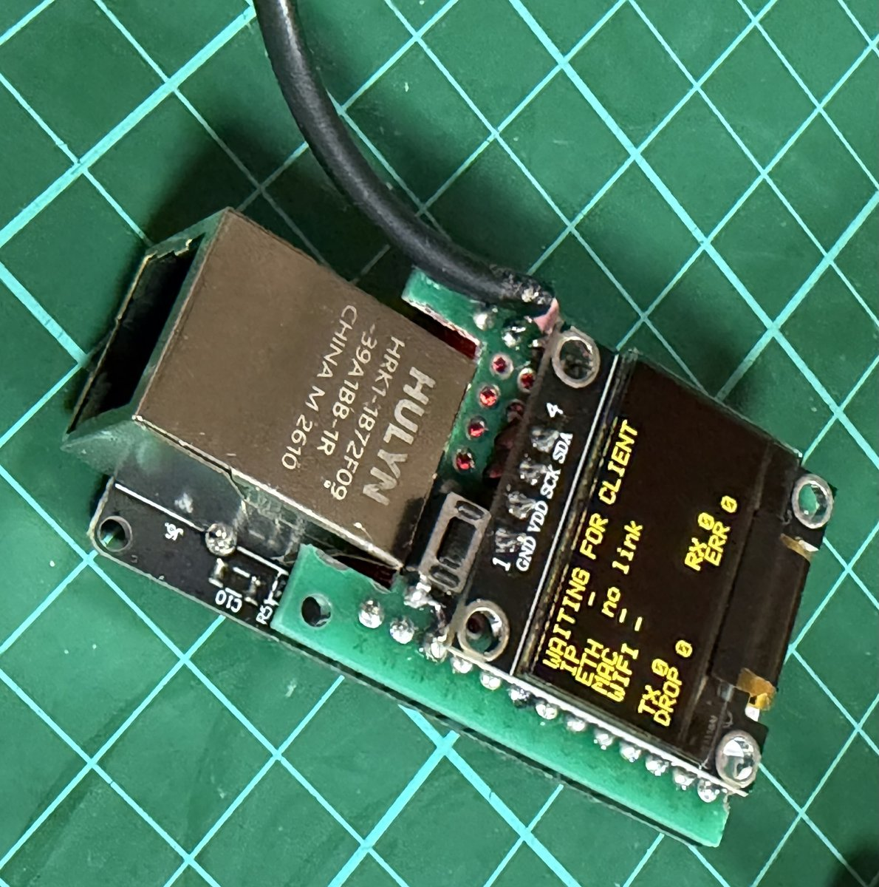

# WifiRetroGate

<p align="center">
  
</p>

A small Wi-Fi adapter for **one vintage Ethernet computer**: plug a DOS PC,
Windows 3.x machine, Amiga or any other Ethernet-equipped retro machine into it,
and it joins your Wi-Fi network as if it were on a cable. Old protocols like
**IPX** keep working, so DOS network games run over Wi-Fi.

It runs on a **WT32-ETH01** board (ESP32 + LAN8720 Ethernet, about 10 EUR),
optionally with a small OLED display and a button.

```text
  vintage computer                 WifiRetroGate                    your network
 +----------------+  Ethernet  +-------------------+   Wi-Fi    +--------------+
 | DOS / Win 3.x  |------------| WT32-ETH01        | ~ ~ ~ ~ ~  | access point |--- LAN,
 | Amiga, 6502... |   cable    | + OLED + button   |            | / router     |    Internet
 +----------------+            +-------------------+            +--------------+
```

Released into the public domain under **CC0 1.0** (see `LICENSE`).

---

## How it works, in one paragraph

A normal Wi-Fi client can only send frames from its own MAC address, which is
why ordinary "Ethernet to Wi-Fi bridges" either translate addresses (and break
non-IP protocols such as IPX, whose addresses contain the MAC) or route IP only.
WifiRetroGate supports exactly **one** wired machine, so it simply **takes over
that machine's MAC address** on the Wi-Fi side and forwards frames unchanged.
To the access point, the retro machine *is* the Wi-Fi client. Details in
[`docs/HOW-IT-WORKS.md`](docs/HOW-IT-WORKS.md).

## How this differs from other Ethernet-to-Wi-Fi bridges

Most ESP32 bridges for this board route or NAT: the wired device gets a
private address behind the ESP32. That is fine for getting a modern device
online, but the retro machine is then hidden from the network and anything
that is not plain outgoing TCP/IP breaks: IPX games, NetBIOS, being pinged
or hosting a server.

WifiRetroGate is a bridge for exactly one machine and takes over its MAC
address, so the machine is a normal member of the network:

- **IPX works**, in all four frame types. The ESP32 Wi-Fi hardware mangles
  some of them (lost 802.3 length fields, no real 802.1H support); the
  firmware works around each one, measured over the air, and tested with Doom.
- **Built to stay connected**: up to 8 saved networks, strongest first,
  retries forever, leaves Wi-Fi cleanly before every restart. An open Telnet
  session survives even a firmware update.
- **Set up from the retro machine itself**: `WRG.COM` with only a packet
  driver, or DHCP and `telnet 192.0.2.1`. No phone or laptop needed.
- **Tells you what is wrong**: the display shows why it does not work, the
  machine's IP address, whom it is looking for and whether its DHCP gets an
  answer.

If you need several wired machines behind one ESP32, a NAT or routing
project is the better fit.

## What it does

- Transparent bridge for one machine: DHCP, ARP, TCP/IP, IPv6, multicast and
  IPX pass through. No settings on the retro machine; it learns the machine's
  MAC by itself (a new machine: unplug and replug the cable).
- **IPX** in all four frame types: 802.2 (ODI default), raw 802.3 (old
  `IPX.COM`), SNAP, and Ethernet II (with a limit, see below).
- **WPA2 / WPA3** and open networks, up to **8 saved**, strongest first.
- **Setup mode**: a web form for phones (opens by itself), or from the retro
  machine. Starts when no network is saved or on a long button press, and goes
  back to bridge mode after 10 minutes without use.
- **Display** (optional 128x64 OLED): status and the reason when something
  fails, the machine's IP, hints. Turns off when nothing changes, and moves the
  text a pixel every minute against burn-in.
- **Console** over serial, Telnet (`192.0.2.1`) or raw frames (`WRG.COM` on DOS,
  `tools/wrg.py` on Linux).
- **28 Mbit/s down / 30 up** measured, far more than a 10 Mbit card can use.
  CPU drops to 80 MHz when idle, with no Wi-Fi power saving, so no lost frames.

## What it cannot do (yet)

Limits of the design:

- **One machine only.** Several machines behind a switch: only the learned one
  gets through (the console shows the others with `macs`). Never connect the
  WifiRetroGate's Ethernet port to your normal LAN.
- **2.4 GHz only** (ESP32). Many phone hotspots default to 5 GHz: on an iPhone
  enable "Maximize Compatibility", on Android set the hotspot band to 2.4 GHz.
- **No WPA2-Enterprise** (802.1X), **no hotel/cafe login pages** (captive
  portals).
- **Hidden networks** are only found when another saved network is visible
  (known gap).
- **Guest networks with client isolation** let the machine reach the Internet
  but not other machines (no IPX games). Ask the network owner to disable it.

Limits of the ESP32 hardware (measured, see `docs/HOW-IT-WORKS.md`):

- **Ethernet II IPX sent from the retro machine arrives at other machines as
  SNAP.** Between two WifiRetroGates it works (the firmware sends an extra
  copy they understand). Everything else, use **802.2** (the ODI default);
  the display shows `IPX: use 802.2 frame` when it sees Ethernet II IPX.
- 802.2, raw 802.3 and SNAP frames rely on the access point unwrapping them in
  the usual way. This worked with the access points tested so far; a very
  strict access point could reject them.

Not implemented yet:

- **BOOTP** for Trumpet Winsock 2.x (most routers do not answer BOOTP; planned:
  translate the BOOTP request into a DHCP lease from the router). Until then,
  give Trumpet a static IP outside the router's DHCP range.
- Firmware updates over the network, FTP, a carrier PCB.

Other things to know:

- On the very first start with a new machine, its first frame teaches the MAC
  and is lost while Wi-Fi connects; protocols retry, so you rarely notice.
  After that the MAC is saved and Wi-Fi connects at power-on.
- The console has no password. It is only reachable from the retro machine
  (Telnet on the service address, `WRG.COM`), the serial port, and the setup
  access point (WPA2, its password is shown on the display).
- **Without a display the setup access point is open** (nobody could read a
  password). While setup mode is on, anyone nearby could join it and add a
  network. It cannot show saved passwords. Finish the setup and it is gone.

---

## Hardware

| Part | Notes |
|---|---|
| WT32-ETH01 | ESP32 + LAN8720, 4 MB flash, 10/100 Ethernet with auto MDI-X |
| 0.96" 128x64 I2C OLED (optional) | SSD1306 or SH1106, address 0x3C or 0x3D |
| Push button (optional) | any momentary button |
| USB-serial adapter, **3.3 V logic** | for flashing and the serial console |
| 5 V supply, ~0.5 A | USB charger, USB port, or the retro PC's 5 V |

## Wiring

```text
                         WT32-ETH01
                  +-----------------------+
   USB-serial     |                       |      OLED (I2C, optional)
   (3.3 V logic)  |                       |      +-------------+
   GND ---------- | GND             3V3   |----- | VCC         |
   TX  ---------- | RX0  (GPIO3)    GND   |----- | GND         |
   RX  ---------- | TX0  (GPIO1)    IO33  |----- | SDA         |
                  |                 IO32  |----- | SCL         |
   flashing only: |                       |      +-------------+
   IO0 --+        | IO0                   |
         |        |                       |      setup button (optional)
   GND --+        |                 IO4   |----o  o----+
   (jumper)       |                       |   button   |
                  |                 GND   |------------+
   5 V supply --- | 5V                    |
   GND ---------- | GND             RJ45  |===== Ethernet cable to the
                  +-----------------------+      retro machine ONLY
```

- Use **TX0/RX0** (GPIO1/3) for the serial cable. The pins labelled
  **TXD/RXD** are a different UART (GPIO17/5) and do not work for flashing.
- On many boards **IO33 is labelled 485_EN** and **IO32 is labelled CFG**.
- Feed **5 V into the 5V pin** (never into 3V3). The board has its own 3.3 V
  regulator. The OLED gets 3.3 V from the 3V3 pin.
- The button needs no resistor (internal pull-up).
- GPIO0 is also the 50 MHz Ethernet clock input: the IO0-GND jumper is only for
  flashing, remove it afterwards. The on-board boot button cannot be used as
  the setup button.

Power from the retro PC itself (switches on and off with it):

```text
   PC drive power (Molex)            WT32-ETH01
   +---------------------+
   | yellow  +12 V       |  not used!
   | black   GND  -------|------------ GND
   | black   GND         |
   | red     +5 V -------|------------ 5V
   +---------------------+
   Double-check: red = +5 V. +12 V destroys the board.
```

## Install (no building needed)

Download `wifiretrogate-VERSION.zip` from the releases. It contains a complete
image for the WT32-ETH01 and `FLASHING.md` with all details.

1. Wire a USB-serial adapter (3.3 V logic) as shown above: GND, TX -> RX0,
   RX -> TX0, 5 V to the 5V pin, and the **IO0 -> GND jumper**. Power on.
2. Flash `wifiretrogate-VERSION-wt32-eth01.bin` at address **0x0**:
   - **In the browser** (Chrome or Edge, nothing to install): Espressif's web
     flasher at <https://espressif.github.io/esptool-js/>. Connect, choose the
     adapter's serial port, add the file and change the suggested address
     `0x1000` to **`0x0`**, **Program**.
   - **Or with esptool** (`pip install esptool`):
     ```sh
     esptool --chip esp32 -p /dev/ttyUSB0 -b 460800 write-flash 0x0 wifiretrogate-VERSION-wt32-eth01.bin
     ```
3. Remove the jumper, power-cycle, and continue with **First setup** below.

The complete image also erases saved settings. To update and keep your saved
networks, write only the firmware parts (see `FLASHING.md`):

```sh
esptool --chip esp32 -p /dev/ttyUSB0 -b 460800 write-flash \
    0xf000 parts/ota_data_initial.bin 0x20000 parts/wifiretrogate.bin
```

## Build and flash

To build it yourself instead: needs [ESP-IDF](https://docs.espressif.com/projects/esp-idf/)
v6.1 (tested) for the ESP32 target.

```sh
. ~/esp/esp-idf/export.sh            # or however you activate ESP-IDF
cd firmware
idf.py set-target esp32
idf.py build
```

Flashing, with the USB-serial adapter wired as above:

```sh
# 1. IO0 -> GND jumper on, then power on (download mode)
idf.py -p /dev/ttyUSB0 flash         # CH343 adapters: /dev/ttyACM0
# 2. jumper off, power-cycle
idf.py -p /dev/ttyUSB0 monitor       # log and console, Ctrl+] to quit
```

Optional settings in `idf.py menuconfig` -> *WifiRetroGate* and
*WifiRetroGate display*: an initial Wi-Fi network (handy for testing; it ends up
in `sdkconfig`, never publish that file), the service address, the button pin,
OLED pins/address/type/rotation/contrast/screen-off time.

To start from scratch (forget networks and the client MAC):
`idf.py -p /dev/ttyUSB0 erase-flash`, then flash again.

## First setup

1. Power it on. With no saved network it starts in **setup mode**; the display
   (and the serial log) show the access point name and password:

   ```text
   SETUP MODE

   Join Wi-Fi:
   WifiRetroGate-3F2A
   PASS 7k2m9qx4
   http://192.168.4.1
   or telnet 192.0.2.1
   ```

   **No display?** Then the access point `WifiRetroGate-XXXX` is **open**, no
   password needed (the serial log says `open (no display found)`).

2. Join that network with a phone. The setup page opens by itself (otherwise
   browse to `http://192.168.4.1`). Pick your network, enter the password,
   **Save**, then **Finish and connect**.

   **Without a phone**, from the retro machine on the Ethernet cable: get an
   address by DHCP (setup mode has a small DHCP server, `192.0.2.x`), then
   `telnet 192.0.2.1`. Or, on DOS without TCP/IP, use `WRG` (see below). Or use
   the serial console (115200 baud). Type `wifi add NAME PASSWORD`, then
   `reboot`, and get a new address afterwards (run DHCP again): the setup
   lease is only for setup mode.
3. Connect the retro machine with an Ethernet cable and switch it on. When it
   sends its first frame, WifiRetroGate learns its MAC and connects.

Later: long press (2 s) on the button for setup mode, short press to wake the
display. Or use the console (`wifi add`, `wifi forget`, `setup`). Setup mode
goes back to bridge mode by itself after 10 minutes without use (no phone on
the access point, no Telnet session, no console command), unless no network is
saved.

## Using it

**On the retro machine** nothing needs configuring:

- TCP/IP: use DHCP (or a static IP in your LAN, with a gateway).
- IPX: the defaults are fine. Novell ODI without `NET.CFG` uses 802.2. If you
  set a frame type, prefer `FRAME Ethernet_802.2`.

**Display** (bridge mode):

```text
+---------------------+
|OK HomeNet     -48dBm|   <- works? and if not, why:
|IP   192.168.1.20    |      WIFI: wrong password / no known net /
|ETH  LINK 10M half   |      connecting...   ETH: no cable
|MAC  004063123456    |      WAITING FOR CLIENT
|WIFI HomeNet         |
|ASKS 192.168.1.1     |   <- hints, taking turns every 3 s when several apply:
|TX 18294   RX 17622  |      hotspot? use 2.4 GHz / IPX: use 802.2 frame /
|DROP 3      ERR 0    |      telnet 192.0.2.1 ok / DHCP: no answer / ASKS ...
+---------------------+
```

The IP address is the one the retro machine uses, learned from its own ARP
packets: `IP   -` until it has used IP, `+1` when it used another address in
the last 10 minutes (`status` lists them all). `ASKS` is the last address it
looked for with ARP, normally its gateway: with an unknown device it tells
which network the device expects. `DHCP: no answer` means it keeps asking for
an address and nothing answers (no DHCP on that network, or no Wi-Fi). Handy
for finding the address of any Ethernet device: plug it in and power it up.

**No Wi-Fi at all since power-on** (every saved network tried, none reached):
WifiRetroGate answers the machine's ARP requests for its gateway itself, so a
machine that has an address (static, or one left from earlier) can still
`telnet 192.0.2.1` and add a network (`telnet 192.0.2.1 ok` on the display).
It hands out no addresses, and once Wi-Fi has connected it never does this
again until the next restart. When Wi-Fi connects, it asks the real router for
the same addresses on the machine's behalf, so the machine's ARP cache points
at the real gateway again. A machine without an address: use `WRG`, or the
button for setup mode.

**Console** - serial (115200 8N1), `telnet 192.0.2.1` from the retro machine
(also in setup mode; from a phone on the setup access point
`telnet 192.168.4.1`), `WRG` on DOS (see below) or
`sudo python3 tools/wrg.py eth0`:

```text
status              current state          counters        frame counters
scan                networks in range      log             recent events
macs                machines seen on Ethernet
wifi list           saved networks         wifi add NAME [PASSWORD]
wifi forget NAME                           reconnect       search again
client              client MAC; client forget | client set MAC
setup               setup mode (access point)
version             firmware, uptime, free RAM, CPU clock
reboot              restart, bridge mode   factory-reset   erase all settings
```

Quote network names with spaces: `wifi add "My Network" secret123`.

`192.0.2.1` is outside every real network (RFC 5737), so the retro machine
sends it to its gateway, and WifiRetroGate picks those packets up before they
leave. No settings, and the rest of your LAN cannot reach the console.

In bridge mode it needs a retro machine with a working IP setup (normally from
the router's DHCP, so Wi-Fi must be connected). In setup mode WifiRetroGate
gives the retro machine an address itself (DHCP, `192.0.2.x`)
and `192.0.2.1` is its own address on the cable, so the same command works for
the first setup.

## Console on DOS without TCP/IP: WRG.COM

`tools/WRG.COM` (1.8 KB, any PC from the 8088 up) needs nothing but the
packet driver for the network card. No TCP/IP, no IP address, no settings:

```text
NE2000 0x60 3 0x300          load your card's packet driver (example)
WRG                          interactive prompt, "exit" quits
WRG status                   one command; WRG scan > NETS.TXT also works
WRG wifi add "My Network" secret123
```

It finds the packet driver by itself (INT 60h-80h) and talks to WifiRetroGate
with raw Ethernet frames, so it works even when Wi-Fi is down or the network
has no DHCP: handy for setting up a new network from the retro machine
itself. Works in bridge and setup mode. Esc stops
waiting for an answer. ODI-only setups can load ODIPKT to get a packet driver
next to IPX. Source: `tools/wrg.asm` (`nasm -f bin -o WRG.COM wrg.asm`).

## Tools (Linux)

| Tool | Purpose |
|---|---|
| `tools/wrg.py IFACE [COMMAND]` | console over raw Ethernet frames, for a Linux machine as the client |
| `tools/ipxtest.py send/listen IFACE` | sends/receives IPX test frames in all four encapsulations and reports what arrives in which form |
| `tools/bootptest.py IFACE` | checks whether a network answers plain BOOTP (Trumpet Winsock 2.x) |

All need root (raw sockets) and only the Python standard library. Testing
procedure and results: [`docs/TESTING.md`](docs/TESTING.md).

## Repository layout

```text
LICENSE              CC0 1.0
README.md            this file
docs/HOW-IT-WORKS.md design, ESP32 quirks and how the firmware handles them
docs/TESTING.md      test procedure and measured results
docs/CONFIG-PROTOCOL.md  raw-frame configuration protocol (EtherType 0x88B5)
firmware/            ESP-IDF project for the WT32-ETH01
tools/               Linux test and configuration tools
```

## License

To the extent possible under law, the authors have waived all copyright and
related rights to WifiRetroGate (**CC0 1.0 Universal**, see `LICENSE`). Use it
for anything, no attribution required.

Third-party parts: the firmware is built with Espressif's ESP-IDF (Apache 2.0,
not included here; its closed Wi-Fi libraries have their own license). The
display font in `firmware/main/font5x8.c` is a 5x7 font: the ASCII characters
follow the character set of the Hitachi HD44780 LCD controller (A00 ROM), the
Latin-1 characters were drawn for this project.
